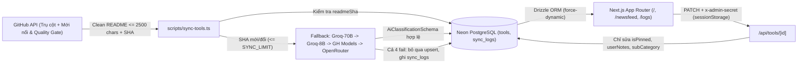

# Kiến trúc hệ thống (`ARCHITECTURE.md`)

## 1. Luồng dữ liệu tổng thể



## 2. Cấu trúc thư mục chuẩn

```text
.
├── .env.example
├── AGENTS.md
├── .agents/
│   ├── rules/
│   │   ├── core-security-stack.md
│   │   ├── db-worker-standards.md
│   │   └── ui-standards.md
│   └── skills/
│       ├── implement-feature/SKILL.md
│       ├── debug/SKILL.md
│       ├── explain-code/SKILL.md
│       └── build-and-ship/SKILL.md
├── docs/
│   ├── PRD.md
│   ├── ARCHITECTURE.md
│   ├── DATA-SCHEMA.md
│   ├── API-CONTRACTS.md
│   ├── PROJECT-RULES.md
│   └── CHANGELOG.md
├── .github/workflows/
│   └── daily-sync.yml
├── drizzle.config.ts
├── scripts/
│   ├── load-env.ts
│   ├── sync-tools.ts              # CLI entrypoint + re-export tương thích
│   ├── backfill-search-text.ts
│   └── lib/
│       ├── github.ts              # Barrel re-export
│       ├── github/
│       │   ├── streams.ts         # 24 luồng tìm kiếm & rotate/all
│       │   ├── readme-cleaner.ts  # Làm sạch & ưu tiên đoạn README
│       │   └── client.ts          # Gọi GitHub API & Quality Gate
│       ├── classifier.ts          # Barrel re-export (./classifier/index)
│       ├── classifier/
│       │   ├── providers.ts       # Cấu hình 10 tầng AI provider
│       │   ├── cooldown.ts        # Quản lý cooldown 429/5xx/timeout
│       │   ├── prompts.ts         # System/User prompt & parser JSON
│       │   └── index.ts           # Điều phối fallback lẻ & batch
│       └── sync/
│           ├── upsert.ts          # Đối chiếu DB, upsert & sync_logs
│           └── reclassify.ts      # Luồng phân loại lại SYNC_RECLASSIFY
└── src/
    ├── config/
    │   └── taxonomy.ts
    ├── db/
    │   ├── index.ts
    │   └── schema.ts
    ├── hooks/
    │   ├── useSearchSuggest.ts    # Debounce, AbortController, phím tắt ↑/↓/Enter/Esc
    │   └── useToolMutations.ts    # PATCH /api/tools/[id] & AdminSecretModal
    ├── lib/
    │   ├── validator.ts
    │   ├── auth.ts
    │   ├── admin-secret-storage.ts
    │   ├── sanitize-error.ts
    │   ├── scroll-lock.ts
    │   ├── search-engine.ts       # Barrel re-export
    │   ├── search/
    │   │   ├── normalize.ts       # Chuẩn hóa tiếng Việt & stopwords
    │   │   ├── synonyms.ts        # Từ điển đồng nghĩa Việt–Anh & ngách
    │   │   ├── parser.ts          # parseSearchQuery, replaces & conceptGroups
    │   │   └── search-text.ts     # buildToolSearchText
    │   ├── tool-query.ts
    │   ├── ui-helpers.ts
    │   ├── newsfeed.ts            # Barrel re-export
    │   ├── newsfeed/
    │   │   ├── scoring.ts         # computeRadarScore & selectDiverseTools
    │   │   ├── quality.ts         # computeQualityRating & buildNewsfeedHighlight
    │   │   ├── toolkits.ts        # 6 Bộ công cụ & buildCuratedToolkits
    │   │   └── filters.ts         # parseNewsfeedParams, URL & buildNewsfeedData
    │   └── queries/
    │       ├── tools-page-query.ts # Truy vấn DB trang / & /newsfeed
    │       └── logs-query.ts       # Truy vấn DB trang /logs
    ├── components/
    │   ├── AdminSecretModal.tsx
    │   ├── Pagination.tsx
    │   ├── Sidebar.tsx
    │   ├── SidebarContent.tsx
    │   ├── SidebarCategoryTree.tsx
    │   ├── SearchToolbar.tsx
    │   ├── SearchSuggestDropdown.tsx
    │   ├── NewsfeedControls.tsx
    │   ├── NewsfeedItem.tsx
    │   ├── QualityStars.tsx
    │   ├── ToolkitShowcase.tsx
    │   ├── ToolCard.tsx
    │   ├── ToolCardHeader.tsx
    │   ├── ToolCardDetails.tsx
    │   ├── ToolNoteEditor.tsx
    │   └── RelativeTime.tsx
    └── app/
        ├── layout.tsx
        ├── loading.tsx
        ├── error.tsx
        ├── page.tsx
        ├── newsfeed/
        │   ├── page.tsx
        │   └── loading.tsx
        ├── logs/
        │   ├── page.tsx
        │   └── loading.tsx
        └── api/
            └── tools/
                ├── suggest/
                │   └── route.ts
                └── [id]/
                    └── route.ts
```

## 3. Thành phần kỹ thuật cốt lõi
- **Database Driver (`src/db/index.ts`, `drizzle.config.ts`):** `sanitizeDatabaseUrl()` xóa `channel_binding` khỏi URL (giữ `sslmode=require`); app dùng HTTP driver `neon()` với `DATABASE_URL`; Drizzle migration ưu tiên `DATABASE_URL_UNPOOLED` (fallback `DATABASE_URL`).
- **Tầng truy vấn & nghiệp vụ tách lớp (`src/lib/`):** Các module lớn được chia nhỏ đơn trách nhiệm vào `src/lib/search/`, `src/lib/newsfeed/`, và truy vấn DB thuần đặt tại `src/lib/queries/` (`tools-page-query.ts`, `logs-query.ts`), duy trì barrel re-export (`src/lib/search-engine.ts`, `src/lib/newsfeed.ts`) để tương thích ngược hoàn toàn.
- **Worker (`scripts/load-env.ts`, `scripts/sync-tools.ts`, `scripts/lib/`):** `import "./load-env";` (`dotenv.config({ path: ".env.local" })`) luôn đặt ở dòng đầu tiên trước `@/db`; phân tách rõ `scripts/lib/github/`, `scripts/lib/classifier/` và `scripts/lib/sync/` (giữ barrel `github.ts`, `classifier.ts` và re-export trên `sync-tools.ts`); bọc `try/catch` từng repo và ghi 1 dòng tổng kết vào `sync_logs`.
- **UI & Custom Hooks (`src/app/`, `src/components/`, `src/hooks/`):** Dark Mode (`bg-zinc-950`, card `bg-zinc-900/60`, `border-zinc-800`, `emerald-400/500`), `export const dynamic = "force-dynamic"`, tách logic client sang custom hooks (`useSearchSuggest.ts`, `useToolMutations.ts`) và subcomponents (`SearchSuggestDropdown.tsx`, `ToolCardHeader.tsx`, `SidebarCategoryTree.tsx`); các `page.tsx` (`/`, `/newsfeed`, `/logs`) chỉ đọc `searchParams`, gọi hàm query và ráp layout.
- **GitHub Actions (`.github/workflows/daily-sync.yml`):** `cron: "0 19 * * *"` (02:00 sáng VN) + `workflow_dispatch` (input `limit` mặc định `"25"`), nạp secrets `DATABASE_URL`, `GITHUB_TOKEN: ${{ secrets.GH_PAT }}`, `GROQ_API_KEY`, `OPENROUTER_API_KEY`.
