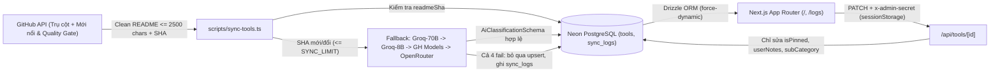

# Kiến trúc hệ thống (`ARCHITECTURE.md`)

## 1. Luồng dữ liệu tổng thể



## 2. Cấu trúc thư mục chuẩn

```text
.
├── .env.example
├── AGENTS.md
├── .agents/
│   ├── rules/
│   │   ├── core-security-stack.md
│   │   ├── db-worker-standards.md
│   │   └── ui-standards.md
│   └── skills/
│       ├── implement-feature/SKILL.md
│       ├── debug/SKILL.md
│       ├── explain-code/SKILL.md
│       └── build-and-ship/SKILL.md
├── docs/
│   ├── PRD.md
│   ├── ARCHITECTURE.md
│   ├── DATA-SCHEMA.md
│   ├── API-CONTRACTS.md
│   ├── PROJECT-RULES.md
│   └── CHANGELOG.md
├── .github/workflows/
│   └── daily-sync.yml
├── drizzle.config.ts
├── scripts/
│   ├── load-env.ts
│   ├── sync-tools.ts
│   └── lib/
│       ├── github.ts
│       └── classifier.ts
└── src/
    ├── config/
    │   └── taxonomy.ts
    ├── db/
    │   ├── index.ts
    │   └── schema.ts
    ├── lib/
    │   ├── validator.ts
    │   └── auth.ts
    ├── components/
    │   ├── Sidebar.tsx
    │   ├── SearchToolbar.tsx
    │   ├── ToolCard.tsx
    │   └── RelativeTime.tsx
    └── app/
        ├── layout.tsx
        ├── page.tsx
        ├── logs/
        │   └── page.tsx
        └── api/
            └── tools/
                └── [id]/
                    └── route.ts
```

## 3. Thành phần kỹ thuật cốt lõi
- **Database Driver (`src/db/index.ts`, `drizzle.config.ts`):** `sanitizeDatabaseUrl()` xóa `channel_binding` khỏi URL (giữ `sslmode=require`); app dùng HTTP driver `neon()` với `DATABASE_URL`; Drizzle migration ưu tiên `DATABASE_URL_UNPOOLED` (fallback `DATABASE_URL`).
- **Worker (`scripts/load-env.ts`, `scripts/sync-tools.ts`):** `import "./load-env";` (`dotenv.config({ path: ".env.local" })`) luôn đặt ở dòng đầu tiên trước `@/db`; `SYNC_LIMIT` mặc định `20`; giãn cách `sleep(1500)` sau mỗi repo phân loại AI; bọc `try/catch` từng repo và ghi 1 dòng tổng kết vào `sync_logs`.
- **UI (`src/app/`, `src/components/`):** Dark Mode (`bg-zinc-950`, card `bg-zinc-900/60`, `border-zinc-800`, `emerald-400/500`), `export const dynamic = "force-dynamic"`, lọc URL Params (`q`, `sub`, `level`, `sort`, `pinned`), Sidebar 2 tầng (7 nhóm / 25 ngách + đếm chính/phụ), `SearchToolbar` (`Ctrl + K` / `/`), `ToolCard` dùng `<RelativeTime />` (SSR `YYYY-MM-DD` → mount tương đối tiếng Việt), trang `/logs`.
- **GitHub Actions (`.github/workflows/daily-sync.yml`):** `cron: "0 19 * * *"` (02:00 sáng VN) + `workflow_dispatch` (input `limit` mặc định `"25"`), nạp secrets `DATABASE_URL`, `GITHUB_TOKEN: ${{ secrets.GH_PAT }}`, `GROQ_API_KEY`, `OPENROUTER_API_KEY`.
